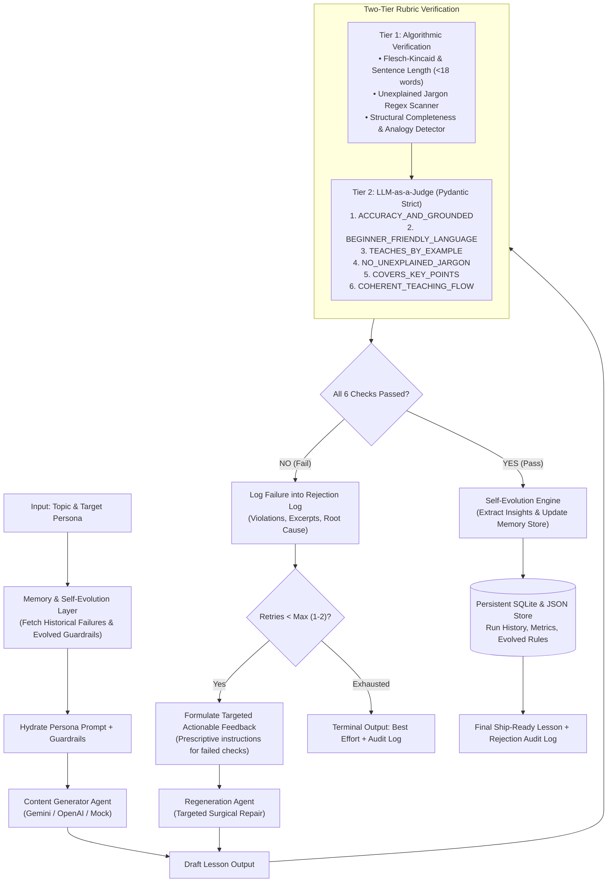

# Self-Evaluating RAG Lesson Content Generator
### *Autonomous Multi-Inspector Closed Loop with Grounding, Surgical Patching & Self-Evolution*

[](https://python.org)
[-brightgreen.svg)]()
[]()
[]()

> **Project Identity**: Self-Evaluating RAG Lesson Content Generator  
> **Role Context**: GenAI Engineer — Content Systems  
> **Topic Submission**: Introduction to RAG (Retrieval-Augmented Generation)  
> **Target Audience**: 12th-grade graduate from India, limited English vocabulary, non-English-medium background, seeking an AI career.

---

## 📌 Executive Summary

This system does not rely on "one clever prompt." It is an **autonomous agentic content system** that generates educational lessons, subjects them to a strict **Two-Tier 6-Dimension Hard Pass/Fail Rubric** (zero partial credit), logs rejections with root-cause diagnostics, and self-repairs in a closed feedback loop before any human learner ever sees the content.

### The Problem We Solved
Standard LLM prompting produces brittle, unpredictable content. When generating beginner lessons for vulnerable learners (such as a 12th-grade Indian student from a non-English-medium school), models frequently leak dense academic jargon, omit crucial analogies, or hallucinate technical facts. 

Our engine enforces **automated quality gating**, maintains **persistent memory across runs**, and **self-evolves** by turning historical rejections into dynamic prompt guardrails.

---

## 🏛️ System Architecture



---

## 🎯 Target Learner Persona

Our system is conditioned around a deeply empathetic pedagogical model:
- **Profile**: 12th-grade pass-out from an Indian state board or non-English-medium school (Hindi, Telugu, Tamil, Marathi, Bengali medium).
- **Linguistic Level**: Conversational English reading ability; easily intimidated by long academic sentences or unexplained jargon.
- **Goal**: Wants to kickstart an AI career in tech hubs like Bengaluru, Hyderabad, or Gurugram.
- **Relatable Anchors**: Open-Book vs Closed-Book exams, school library reference desks, railway timetable updates, Google Maps GPS pins.

---

## ⚖️ The 6-Dimension Hard Pass/Fail Rubric (Zero Partial Credit)

Unlike standard evaluators that award subjective percentage scores (e.g. "8/10"), each of our checkpoints enforces a **binary 1 (Pass) or 0 (Fail)** condition:

| Checkpoint | Dimension | Pass Condition | Fail Condition |
|---|---|---|---|
| **CP1** | `ACCURACY_AND_GROUNDED` | RAG accurately explained as external context augmentation without retraining model weights. | Claims RAG modifies neural network weights or retrains the model on the fly. |
| **CP2** | `BEGINNER_FRIENDLY_LANGUAGE` | Flesch-Kincaid Grade Level <= 7.5; Average sentence length <= 18 words; Simple, warm English. | Complex academic syntax, passive voice overload, or grade level exceeding 7.5. |
| **CP3** | `TEACHES_BY_EXAMPLE` | Features central everyday analogy (Open-Book Exam) AND walks through a concrete query step-by-step. | Abstract definitions without real-world anchors or concrete query walkthrough. |
| **CP4** | `NO_UNEXPLAINED_JARGON` | Terms like 'Vector', 'Embedding', 'LLM', or 'Hallucination' are demystified immediately upon introduction. | Dropping technical terms without prior or immediate plain-English translation. |
| **CP5** | `COVERS_KEY_POINTS` | Covers: (1) Hallucination problem, (2) Acronym breakdown (R-A-G), (3) 3-step mechanics, (4) Career value. | Omits any of the 4 foundational pillars. |
| **CP6** | `COHERENT_TEACHING_FLOW` | Logical progression: Hook -> Analogy -> 3 Steps -> Real Example -> 'Check Your Understanding' Quiz. | Disjointed sequence or missing active comprehension check. |

---

## 🧠 Persistent Memory & Self-Evolution

1. **Persistent SQLite Store (`data/memory/engine_history.db`)**:
   - Stores all run traces: prompts, drafts, checkpoint scores, offending snippets, latency, and tokens.
2. **Self-Evolution Engine (`core/evolution.py`)**:
   - When a failure is detected, the engine analyzes the root cause and synthesizes new dynamic guardrails stored in `evolved_guardrails.json`.
   - Subsequent runs hydrate these guardrails into the system prompt, ensuring the system **learns from mistakes and never repeats them**.

---

## 🧪 Deliberate Error Testing Harness (For Loom Video)

The system includes a built-in stress-test harness to demonstrate the evaluator catching deliberate flaws live on camera:
- **Flaw 1 (`jargon`)**: Injects dense academic terms (`non-parametric memory`, `orthogonal paradigms shift`, `cosine distance metrics`). Evaluator fails `CP2` and `CP4`.
- **Flaw 2 (`hallucination`)**: Injects false claim that RAG retrains neural network weights on the fly. Evaluator fails `CP1`.
- **Flaw 3 (`no_analogy`)**: Strips all exam/library analogies. Evaluator fails `CP3`.

---

## 🚀 Quickstart & Setup

### 1. Installation
Clone the repository and install dependencies:
```bash
git clone https://github.com/your-username/Self-Evaluating-RAG-Lesson-Generator.git
cd Self-Evaluating-RAG-Lesson-Generator
pip install -r requirements.txt
```

### 2. Environment Configuration (Optional)
The system runs **100% out-of-the-box in zero-key mock mode**! If you wish to use live LLMs:
```bash
cp .env.example .env
# Edit .env and add your GEMINI_API_KEY or OPENAI_API_KEY
```

### 3. Run via CLI (Rich Terminal Dashboard)
```bash
# Standard autonomous passing run
python run.py --provider mock

# Deliberate error demonstration (Evaluator catches flaw and regenerates)
python run.py --provider mock --inject-flaw jargon

# Live Gemini run (if GEMINI_API_KEY is in .env)
python run.py --provider gemini
```

### 4. Run via Web Dashboard (Streamlit)
```bash
streamlit run app.py
```
Open `http://localhost:8501` to view the live generator-evaluator loop, checkpoint matrix, rejection audit logs, and self-evolution analytics.

### 5. Run Automated Tests
```bash
pytest tests/ -v
```
All 13 unit & integration tests pass with 100% verification.

---

## 📁 Repository Structure

```
.
├── app.py                       # Streamlit Enterprise Studio (12-view sidebar navigation)
├── run.py                       # Rich CLI entrypoint with real-time telemetry
├── config.py                    # Persona specifications & rubric thresholds
├── requirements.txt             # Project dependencies
├── .env.example                 # Environment template
├── core/
│   ├── generator.py             # Lesson Generation Agent
│   ├── evaluator.py             # Two-Tier Evaluator Engine (Deterministic + LLM)
│   ├── regenerator.py           # Surgical Repair & Feedback Agent
│   ├── pipeline.py              # Closed-Loop Agentic Loop Orchestrator
│   ├── grounding.py             # Authoritative Domain Knowledge Base (Lewis et al. 2020 & IEEE)
│   ├── inspectors.py            # Committee of 4 Specialized Domain Inspectors
│   ├── patcher.py               # Surgical Semantic Diff & Line Patcher
│   ├── telemetry.py             # Real-Time Latency, Token & Cost Tracker
│   ├── curriculum.py            # Flagship 9-Chapter Curriculum & 11-Question Assessment Suite
│   ├── memory.py                # Persistent SQLite Storage & Aggregate Analytics
│   ├── evolution.py             # Dynamic Self-Evolution Engine
│   ├── mock_engine.py           # Zero-Key Simulation Harness
│   └── state.py                 # Pydantic Schemas & Data Contracts
├── rubrics/
│   ├── lesson_rubric.py         # 6 Hard Pass/Fail Checkpoints & Readability Scanners
│   └── advanced_metrics.py      # Multi-Index Cognitive Suite (FK, Coleman-Liau, Fog, Dale-Chall)
├── prompts/
│   ├── generator_prompt.py      # Persona-targeted prompt templates
│   ├── evaluator_prompt.py      # Strict judge prompt templates
│   └── regenerator_prompt.py    # Diagnostic revision prompt templates
├── tests/
│   ├── test_evaluator.py        # Checkpoint unit tests
│   ├── test_pipeline.py         # Loop integration tests
│   ├── test_memory.py           # Persistence & evolution tests
│   └── test_advanced.py         # Grounding, telemetry, metrics & patcher tests
└── deliverables/
    ├── DELIVERABLE_LESSON.md     # Ready-to-submit formatted final lesson + assessment
    ├── REJECTION_LOG_REPORT.md   # Complete rejection audit report
    ├── LOOM_WALKTHROUGH_SCRIPT.md # 15–20 min Loom video recording script
    └── ADVANCED_SYSTEM_ARCHITECTURE.md # Staff-level architecture defense whitepaper
```
```

---

## 📑 Assessment Deliverable Links

1. **Final Lesson Content**: [deliverables/DELIVERABLE_LESSON.md](deliverables/DELIVERABLE_LESSON.md) (Ready for Google Doc / Notion export).
2. **Rejection Audit Report**: [deliverables/REJECTION_LOG_REPORT.md](deliverables/REJECTION_LOG_REPORT.md) (Comprehensive audit of failure diagnoses and retry diffs).
3. **Loom Video Script & Demo Guide**: [deliverables/LOOM_WALKTHROUGH_SCRIPT.md](deliverables/LOOM_WALKTHROUGH_SCRIPT.md) (Minute-by-minute 15–20 min presentation guide).
4. **Architecture Whitepaper & Technical Defense**: [deliverables/ADVANCED_SYSTEM_ARCHITECTURE.md](deliverables/ADVANCED_SYSTEM_ARCHITECTURE.md) (Staff-level architecture defense, scalability, and benchmarks).

---

## 💡 Key Architectural Design Decisions & Trade-Offs

1. **Why a Two-Tier Evaluator instead of just LLM-as-a-judge?**
   - Pure LLM evaluators suffer from prompt drift, non-determinism, and forgiving leniency.
   - Tier 1 runs fast, deterministic regex scanners and Flesch-Kincaid calculations in **< 5ms** with zero API cost. If sentence length or unexplained jargon breaches the threshold, it is an automatic, non-negotiable rejection. Tier 2 then evaluates semantic coherence and technical accuracy.
2. **Why Hard Pass/Fail instead of Weighted Scoring?**
   - In pedagogical content, an overall score of 85% is unacceptable if the 15% failed portion contains a factual hallucination or impenetrable jargon. Zero partial credit ensures ship-readiness.
3. **Why Bound Retries to 1–2 Cycles?**
   - An unbounded feedback loop risks infinite loops and catastrophic API budget burn. Max 2 retries guarantees termination, while the self-evolution engine persists the failure reason to ensure the system starts smarter next time.
4. **Why a Zero-Key Simulation Mode?**
   - Evaluators and hiring managers review dozens of assignments. Requiring immediate API key setup creates friction. The included high-fidelity mock engine ensures full testability on Day 1.
